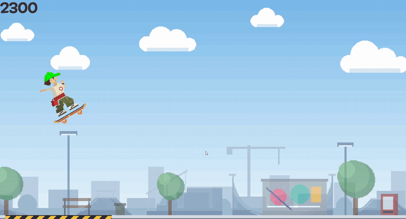

# Sk8ter boii

스케이트보드를 타고 달리며 모자 색을 바꿔 같은 색 링을 통과하는 2D 러너 게임.



## 한 줄 소개

공원 곳곳에 걸린 컬러 게이트를 같은 색 모자로 바꿔서 통과하고, 점프와 플립으로 점수를 쌓아 골인하는 스케이트 러너.

## 플레이

1. [Releases](../../releases)에서 `Sk8terBoii.zip`을 받아 압축을 푼다.
2. `Sk8terBoii.exe`를 실행한다. (Windows)
   - 서명되지 않은 파일이라 SmartScreen 경고가 뜨면 "추가 정보 → 실행"을 누른다.
3. 소스로 열려면 Unity 6000.3.20f1로 이 저장소의 폴더를 연다.

## 조작

| 키 | 동작 |
|---|---|
| Space | 점프 |
| Q / W / E / R | 모자 색 변경 (파랑 / 빨강 / 초록 / 보라) |
| ← / → | 공중에서 기울이기 (flip) |
| ESC | 타이틀로 돌아가기 |

## 게임 특징

- **색 맞추기**: 달리는 중에 모자 색을 바꿔 다가오는 링과 같은 색으로 통과하기. 한 그룹을 전부 통과하면 보너스. 은근 뇌지컬 요구!
- **공중 Trick**: 방향키로 플립을 하여 추가 점수를 얻자. 한 바퀴 돌아서 착지하면 추가 점수!
- **장애물**: 돌에 부딪히거나 구멍에 빠지거나, 잘못된 착지 각도는 게임 오버!
- **점수에 따라 별 획득**: 점수 비율에 따라 별 1~3개와 스테이지별 최고 점수를 기록! 별 3개를 얻을 수 있을까?

| 점수 | 값 |
|---|---|
| 링 | +100 |
| 그룹 보너스 | +300 |
| flip | +200 |

## 구현 내용

- 플레이어 이동, 점프, 경사에 맞춘 기울기와 착지 판정, 넘어짐 연출
- 링·링 그룹, 점수 팝업, 별 계산, 최고 점수 저장
- 경사(킥커·쿼터파이프), 발사대, 갭, 레일
- 카메라 추적, Parallax 배경, Particle Effect(FX), 사운드(SFX)
- 타이틀, 결과 화면, 볼륨 조절, 조작법 패널

## 프로젝트 구조

```
Assets/
  Scripts/    PlayerController, GameManager, Ring, RingGroup, Hazard, GoalFlag,
              LaunchPad, RampShape, CameraFollow, ParallaxLayer, SoundManager, ...
  Sprites/    Anim, FX, UI
  Audio/
  Scenes/     Title, Stage1~3
```

## 제작

- 제작 기간: 3일
- 기획, 코드 작성, 씬 구성, 수치 조정, 스테이지 제작은 직접 진행.

## AI 사용 내역

- **Claude (Anthropic), 웹/앱 채팅**: 기획 검토, 스크립트 구조 의견, 개념·함수 설명, 버그 원인 설명, 예시 스니펫과 코드 리뷰. 받은 코드는 이해한 뒤 내 구조에 맞게 고쳐서 넣었고 주석은 직접 썼다.
- **스프라이트·UI·파티클 텍스처**: Aseprite MCP(pixel-mcp)와 Claude가 작성한 Python(PIL) 스크립트로 생성했고, 선택·배치·교체는 직접 했다.
- **효과음 편집**: 받은 음원을 자르고 루프로 만드는 작업에 Claude가 작성한 Python(numpy, scipy)을 사용했다.
- Unity MCP와 CLI 기반 코딩 에이전트는 사용하지 않았다.

## 크레딧

- 배경음: Music by Audiogreen from Pixabay
- 효과음: Pixabay (Vadim, freesound_community, LIECIO), Mixkit (스케이트보드), Freesound (rail slide by C-V, CC0), sfxr.me
- 폰트: Maplestory

## 라이선스

All rights reserved
